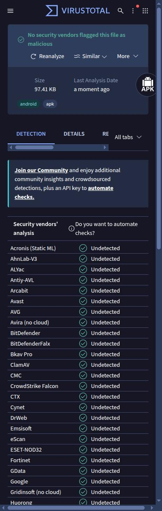

# SxS Overlay

A floating bubble for **Sword x Staff** on Android. Tap it in game to open [SxS Tools](https://sxs.lmthings.com/)
(Loadouts, Level Timer, Season Planner) in a panel over the game, without leaving it.

Unofficial fan tool by LM Things. Not made by or affiliated with the game's developers.

**[Download the latest APK](https://github.com/Lillymara/sxs-overlay/releases/latest)**

## What it does

- **Bubble** that sits where the game draws nothing: on phones, in the empty strip along the top of the screen; on the
  Galaxy Fold (open), on the right edge. Both spots were checked against screenshots of the game's main screens
  (Character, Bed, Cart, Item, Season, events), so the bubble never covers numbers or buttons. Drag it anywhere; drag
  it to the ✕ at the bottom to close it.
- **Panel** showing sxs.lmthings.com. It opens between the game's header and its bottom bar, so your currencies, Back
  and the tabs stay usable. Drag the panel's top bar to move it.
- **Fill from screenshots**: the Level Timer and Season Planner can read your game screens.
  - *Choose screenshots* opens your phone's photo picker.
  - *Read the game screen* (only in this app) reads the screen behind the panel directly, so you don't need to save
    screenshots. The panel hides for a moment while it reads.

## Install

1. Download `SxS-Overlay-x.y.z.apk` from [Releases](https://github.com/Lillymara/sxs-overlay/releases/latest) on your phone
   and open it. Android asks you to allow installs from your browser or Files app; that's normal for apps from outside
   the Play Store.
2. Open **SxS Overlay**, tap **Allow display over other apps**, and turn it on.
3. Tap **Start bubble**, then open Sword x Staff.

Android 8 or newer. Updates install over the previous version.

## Is it safe?

You don't have to take our word for it. Here's how to check.

### VirusTotal scan

The 0.2.0 APK was scanned by [VirusTotal](https://www.virustotal.com/), which runs it through dozens of antivirus
engines.

| | |
|---|---|
| Result | **No security vendor flagged it as malicious: 0 of 65 engines** (8 more gave no verdict: they don't handle this file type or timed out) |
| Full report | [virustotal.com/gui/file/13bc7684…2131](https://www.virustotal.com/gui/file/13bc7684c8c9efb156f4d55b510abea4530dff2bdc2987d1e64c636cf18b2131/detection) |
| Scanned | 23 November 2026 |



### Check that your download is the scanned file

The report above is for one exact file. Its SHA-256 fingerprint is:

```
13bc7684c8c9efb156f4d55b510abea4530dff2bdc2987d1e64c636cf18b2131
```

To check your copy, upload it to [virustotal.com](https://www.virustotal.com/gui/home/upload). If it's the same file,
VirusTotal opens the same report. On a computer you can also run `sha256sum SxS-Overlay-0.2.0.apk` (Linux),
`shasum -a 256 SxS-Overlay-0.2.0.apk` (Mac) or `certutil -hashfile SxS-Overlay-0.2.0.apk SHA256` (Windows).

Every release is signed with the same key. Its certificate SHA-256 is
`3d72ba387a5b2bbc5a715846a78f7e692d24765c7e24c92357535ce69bc724f7`. Android refuses to install an update signed with
any other key over this app.

### What it can access, and why

| Permission | Why |
|---|---|
| Display over other apps | To show the bubble and panel over the game. You turn this on yourself. |
| Internet | To load sxs.lmthings.com in the panel. |
| Foreground service and notifications | Android requires an "is running" notification to keep the bubble alive. Its Stop button closes the bubble. |
| Screen capture (asked only when you tap *Read the game screen*) | To read the game screen. Android asks first, every bubble session, and shows a screen-sharing indicator while it's on. |

It does **not** ask for contacts, location, microphone, camera, storage, accessibility, or your game account. Photos
you pick are only those you choose in Android's photo picker.

**Your screenshots stay on your phone.** Screens are read on your phone by the web page's built-in text reader. They
aren't uploaded anywhere. The panel only loads sxs.lmthings.com; other links open in your normal browser.

### Read or build the code yourself

It's all here: about 1,000 lines of plain Java with no third-party libraries. The interesting parts are
[`OverlayService.java`](app/src/main/java/com/lmthings/sxsoverlay/OverlayService.java) (bubble, panel, screen reading)
and the [manifest](app/src/main/AndroidManifest.xml) (every permission it asks for).

To build it, install JDK 17+ and the Android SDK (platform 35, build tools 35.0.0), then run `gradle assembleRelease`
with Gradle 8.9. The APK is written to `app/build/outputs/apk/release/`. A build from source is signed with *your*
key, so it won't match the fingerprints above and can't update the released app.
